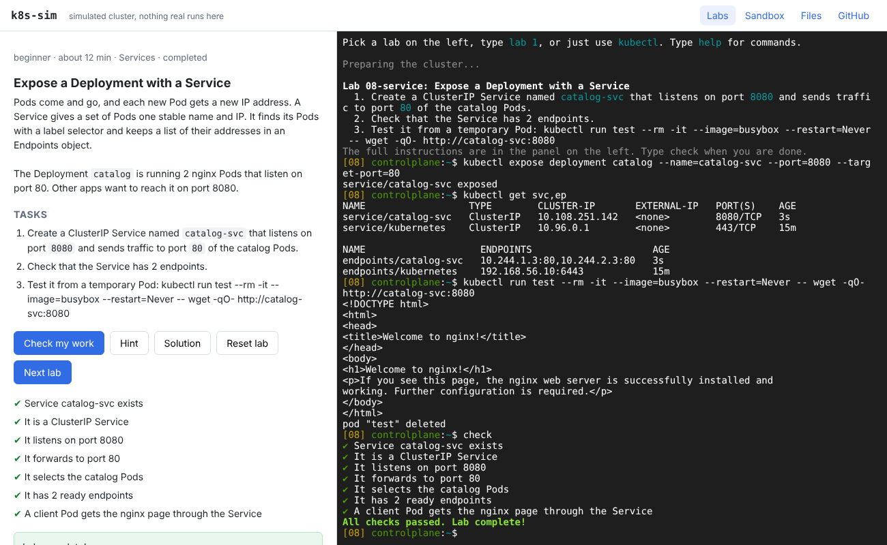

# PodSim

A Kubernetes training simulator. Practice `kubectl` on a simulated cluster, in your terminal or in the browser, along a training path from your first Pod to real-life production scenarios. Every lab checks your work automatically, and a CKAD track with two timed mock exams prepares you for the certification.

Nothing here runs real containers. The simulator models how Kubernetes objects behave: the scheduler places Pods on nodes, the kubelet pulls images and starts containers, Deployments roll out new ReplicaSets, Services collect endpoints. You see the same states, events and error messages a real cluster gives you, without installing anything or paying for a cluster.

**Try it in the browser:** https://sdtslmn.github.io/podsim/



## Why a simulator

Real practice clusters (Killercoda, KodeKloud, kind, minikube) are great once you know the basics. For a first contact they are often too much: you wait for VMs, things break in ways that have nothing to do with what you are learning, and you need an account or a powerful laptop.

PodSim starts instantly, works offline, resets in a second and behaves the same every time. Use it to build muscle memory and understand what happens behind each command, then move to a real cluster.

## Quick start

You need [Node.js](https://nodejs.org/) 20.19 or newer.

```bash
git clone https://github.com/sdtslmn/podsim.git
cd podsim
npm install
npm run sim            # builds and opens the practice shell
```

Inside the shell:

```
controlplane:~$ labs           # the training path
controlplane:~$ lab b1         # start the first lab
controlplane:~$ kubectl run web --image=nginx
controlplane:~$ check          # check your work
controlplane:~$ hint           # stuck? get a hint
```

Other ways to start it:

```bash
npm start                      # open the shell (after npm run build)
npm start -- lab b3            # jump straight to a lab
npm start -- labs ckad         # the CKAD track
npm start -- exam ckad-mock-2  # a timed CKAD mock exam
npm start -- -c "kubectl get nodes -o wide"   # run one command and exit
```

### Browser version

```bash
npm run dev:web                # then open the URL Vite prints
```

The browser version runs entirely client side, so it can be hosted on GitHub Pages. The workflow in `.github/workflows/pages.yml` publishes it on every push to `main` once Pages is enabled for the repository (Settings, Pages, Source: GitHub Actions).

## Teaching with the sandbox

The sandbox is a fresh simulated cluster with no lab attached. Type a command and the class sees what a real cluster would do: Pods move from ContainerCreating to Running, a typo in an image name ends in ImagePullBackOff, a rolling update keeps the old Pods serving until the new ones are ready. Nothing is created anywhere outside the simulator, and `reset` brings back a clean cluster in a second, so you can repeat a demo as often as you like.

In the browser, open the page, click Sandbox and put it on the projector. Learners can follow along on their own laptops with no setup.

## Training path

The labs form one path from zero to production. Each level is split into modules; start at B01 if Kubernetes is new to you, or jump to the level that fits.

### 1. Beginner (16 labs)

Start from zero: what a cluster is, how to run and inspect Pods, and the
everyday objects every Kubernetes user needs.

| Module | Labs |
|---|---|
| First steps | B01 Take a tour of the cluster · B02 Run your first Pod · B03 Write a Pod manifest · B04 Inspect a running Pod |
| Organizing resources | B05 Work in a namespace · B06 Organize Pods with labels |
| Deployments | B07 Create a Deployment · B08 Scale a Deployment · B09 Roll out a new version · B10 Roll back a broken release |
| Services | B11 Expose a Deployment with a Service · B12 Reach a Service by its DNS name |
| Configuration | B13 Configure a Pod with a ConfigMap · B14 Keep a password in a Secret |
| Troubleshooting basics | B15 Fix a Pod that cannot pull its image · B16 Fix a Pod stuck in CrashLoopBackOff |

### 2. Intermediate (22 labs)

The building blocks of real applications: the right workload for each
job, storage, health checks, resources, access control, networking and
packaging.

| Module | Labs |
|---|---|
| Workloads | I01 Run a batch Job in parallel · I02 Schedule work with a CronJob · I03 Run an agent on every node with a DaemonSet · I04 Give each replica a stable identity |
| Multi-container Pods | I05 Prepare content with an init container · I06 Add a log shipping sidecar |
| Storage and configuration | I07 Keep data in a PersistentVolumeClaim · I08 Mount configuration files from a ConfigMap · I09 Configure a Pod with a ConfigMap and a Secret |
| Health and resources | I10 Add readiness and liveness probes · I11 Stop a restart loop caused by a probe · I12 Run a Pod inside a ResourceQuota · I13 Set defaults and limits with a LimitRange |
| Access and security | I14 Give an app read access with a ServiceAccount · I15 Lock down a Pod with a security context |
| Networking | I16 Fix a Service that reaches nothing · I17 Allow only the backend to reach the database · I18 Route HTTP traffic with an Ingress |
| Scheduling | I19 Place Pods on the right nodes |
| Packaging and updates | I20 Tune a rolling update · I21 Deploy and upgrade a Helm chart · I22 Create a staging overlay with Kustomize |

### 3. Advanced (12 labs)

What production teams do every week: safe releases, custom images and
APIs, debugging hard cases, autoscaling and hardening.

| Module | Labs |
|---|---|
| Release strategies | A01 Send a share of traffic to a canary · A02 Switch traffic from blue to green |
| Build and extend | A03 Build, push and run a container image · A04 Use a custom resource · A05 Update a manifest that uses a removed API |
| Observability and debugging | A06 Debug a crashing Deployment · A07 Find the Pod that uses the most CPU · A08 Debug a container that has no shell · A09 Scale on CPU with a HorizontalPodAutoscaler |
| Hardening | A10 Meet the restricted Pod Security Standard · A11 Lock down a namespace with default-deny policies · A12 Call the Kubernetes API from inside a Pod |

### 4. Real-life scenarios (7 labs)

Longer exercises that combine many topics, the way work arrives in real
life: a launch, an outage, a traffic spike, an audit, a bad release,
maintenance and a memory problem.

| Module | Labs |
|---|---|
| Build and launch | S01 Launch day: deploy a three-tier shop |
| Incidents | S02 Outage: checkout is down · S05 Bad release at 2 AM · S07 Reports keep crashing: an OOMKilled container |
| Operations | S03 Traffic spike: autoscale without breaking the budget · S04 Security audit: close the findings · S06 Node maintenance window |

## CKAD track

The CKAD track reuses labs from every level, grouped by the five domains of the CKAD curriculum, plus exam skills and two timed mock exams. In the browser open the **CKAD track** tab; in the terminal run `labs ckad`.

| Domain | Labs |
|---|---|
| Application Design and Build (20%) | B03, I01, I02, I03, I04, I05, I06, I07, A03 |
| Application Deployment (20%) | B07, B09, B10, I20, I21, I22, A01, A02, S05 |
| Application Observability and Maintenance (15%) | B04, B16, I10, I11, A05, A06, A07, A08, S02, S07 |
| Application Environment, Configuration and Security (25%) | B13, B14, I08, I09, I12, I13, I14, I15, A04, A10, A12, S04 |
| Services and Networking (20%) | B11, B12, I16, I17, I18, A11, S01 |
| Exam skills | C01, C02 |

Each lab is a YAML file in [`labs/`](labs), and [`labs/curriculum.yaml`](labs/curriculum.yaml) puts them in order. Writing a new one takes a few minutes, see [docs/writing-labs.md](docs/writing-labs.md).

## Visualizer

The **Visualizer** tab in the browser draws the cluster and updates live as you type commands:

- **Nodes**: every node with its Pods inside, grouped by Deployment, StatefulSet, DaemonSet or Job, coloured by status. New Pods pop in as they start, deleted ones fade out, Pods that cannot be scheduled wait in their own box, and taints, labels, cordons and requested CPU and memory are shown per node.
- **Network**: Ingress rules, Services and the Pods behind them (ready endpoints solid, not ready dashed), and a shield on Pods covered by a NetworkPolicy. Click a policy to outline what it selects and read its rules in plain words. Every request is animated: a green dot when it gets through, a red one where a policy, a missing endpoint or blocked DNS stops it.

Click any Pod for its node, IP, owner, labels, Services and policies. The Visualizer is switched off during the mock exams, like the real exam.

## Mock exams

`ckad-mock-1` and `ckad-mock-2` each have 16 weighted tasks across all five domains, a 120 minute timer and a 66% pass mark, like the real exam. You start on a base node and connect to each task's host with `ssh`, where a separate simulated cluster waits for you. At the end every task is scored automatically, with partial credit per check, and you get the breakdown and a reference solution for each task.

In the browser click **Mock exam**; in the terminal run `npm start -- exam ckad-mock-1` (or `ckad-mock-2`). The questions are original practice material mapped to the public curriculum, not exam questions.

## CKAD coverage

How the [CKAD curriculum](https://github.com/cncf/curriculum) competencies map to the simulator:

| Competency | In PodSim |
|---|---|
| Define, build and modify container images | `docker` and `podman` build from a Dockerfile, `images`, `tag`, `save`, `load`, `push`; Pods pull pushed images with their CMD, ENTRYPOINT, ENV and WORKDIR |
| Choose and use the right workload resource | Deployments, ReplicaSets, DaemonSets, StatefulSets, Jobs (completions, parallelism, backoff, Indexed, TTL), CronJobs (schedules, concurrency, history) |
| Multi-container Pod design patterns | init containers, native sidecars, shared volumes, shared network and `localhost` |
| Persistent and ephemeral volumes | emptyDir, hostPath, ConfigMap, Secret, projected and downwardAPI volumes; PVCs bound by the `standard` StorageClass; StatefulSet volumeClaimTemplates |
| Deployment strategies (blue/green, canary) | Services route by label to every ready Pod, so selector switches and replica splits behave like on a real cluster |
| Rolling updates | maxSurge, maxUnavailable, Recreate, revisions, `rollout history/undo/pause/resume/restart` |
| Helm | `helm repo`, `search`, `show`, `pull`, `create`, `lint`, `template`, `install`, `upgrade`, `rollback`, `history`, `get`, `uninstall`, with Bitnami nginx, apache and redis charts |
| Kustomize | `kubectl kustomize`, `apply -k`, `delete -k`: bases, overlays, generators with hash suffixes, prefixes, labels, images, replicas, patches |
| API deprecations | removed versions fail with the real "no matches for kind" error; `kubectl api-resources`, `kubectl explain` |
| Probes and health checks | liveness, readiness and startup probes (httpGet, tcpSocket, exec, grpc) with real events and restarts |
| Built-in CLI monitoring | `kubectl top pod/node` from a simulated metrics-server, `kubectl events`, `describe`, HorizontalPodAutoscalers |
| Container logs | `logs`, `-c`, `--previous`, `-f`, `--tail`, `--since`, `-l`, logs of Jobs and Deployments |
| Debugging | `describe`, events, `exec -it`, `kubectl debug` (ephemeral containers, `--copy-to`, `node/NAME`), port-forward |
| Resources that extend Kubernetes | CustomResourceDefinitions with schema validation, printer columns and short names |
| Authentication, authorization, admission | RBAC (Roles, ClusterRoles, bindings, `--as`, `auth can-i`, `auth can-i --list`), ServiceAccount tokens, Pod Security Admission, quota and LimitRange admission |
| Requests, limits, quotas | scheduling by requests, OOMKilled on memory limits, ResourceQuota, LimitRange defaults |
| ConfigMaps and Secrets | environment variables, `envFrom`, files, `subPath`, immutable objects, generic, TLS and docker-registry Secrets |
| ServiceAccounts | per-namespace accounts, `automountServiceAccountToken`, calling the API server from a Pod with the token |
| Application security | securityContext (users, groups, fsGroup, capabilities, read-only root, privilege escalation) enforced inside the container |
| NetworkPolicies | ingress and egress rules, pod, namespace and IP block peers, ports, DNS; enforced for `wget`, `curl` and `nc` |
| Services | ClusterIP, NodePort, headless, ExternalName, named target ports, endpoints, DNS names |
| Ingress | ingress-nginx controller on NodePort 30080/30443, host and path rules, path types, default backends, IngressClass |

The simulated cluster reports Kubernetes v1.35, the version the CKAD exam environment used in 2026. The exam moves to newer releases a few weeks after each one, so check the official exam FAQ before you book.

## What is simulated

**Cluster**: one control plane node and two workers, kube-system Pods (etcd, API server, scheduler, controller manager, CoreDNS, kube-proxy, metrics-server), the ingress-nginx controller, a default `standard` StorageClass, default ServiceAccounts and ClusterRoles.

**Controllers**: scheduler (taints and tolerations, nodeSelector, node affinity, requests, cordoned nodes), kubelet (image pulls, init containers, sidecars, probes, restarts with back-off, OOMKilled, ephemeral containers), Deployment, ReplicaSet, DaemonSet, StatefulSet, Job, CronJob, HorizontalPodAutoscaler, Endpoints, PersistentVolume binding and provisioning, ResourceQuota, Ingress status, garbage collection.

**Containers run a shell**: every container runs its command in a small shell interpreter on the simulated clock, with a filesystem built from its image and volumes. `kubectl exec` and `kubectl run --rm -it` give you a prompt inside the container with `ls`, `cat`, `env`, `ps`, `wget`, `curl`, `nc`, `nslookup` and friends. HTTP and TCP traffic goes through Services, DNS and NetworkPolicies to processes that really listen.

**kubectl**: `get` (all output formats, `-l`, `--field-selector`, `--sort-by`, `-A`), `describe`, `explain`, `run`, `create` (all common generators), `apply`/`create`/`delete` with `-f` and `-k`, `kustomize`, `replace --force`, `patch` (strategic, merge, JSON, `--patch-file`), `label`, `annotate`, `scale`, `autoscale`, `expose`, `set`, `rollout`, `logs`, `exec`, `debug`, `port-forward`, `top`, `events`, `cordon`, `drain`, `taint`, `auth can-i`, `wait`, `config`, `api-resources`.

**On the host**: `helm`, `docker`, `podman`, `curl` and `wget` against NodePorts, and a shell with pipes, redirects, heredocs, variables, aliases, `grep`, `sed`, `awk`, `cut`, `sort`, `find`, `base64` and more.

**API server behaviour**: strict field validation, type checks, immutable fields, admission (quota, LimitRange, Pod Security), RBAC, removed API versions, and the real error messages.

Not simulated yet: `--watch`, an editor inside the terminal for `kubectl edit` (use the Files panel or your own editor), Gateway API, several clusters in one kubeconfig. See the [roadmap](docs/roadmap.md).

## How it works

```
packages/core   simulated cluster engine, kubectl emulation, shell, lab runner (no Node APIs, runs in the browser too)
packages/cli    terminal front end (readline, real files in ./podsim-work)
packages/web    browser front end (xterm.js, in-memory files)
labs/           lab definitions in YAML, and curriculum.yaml with the training path and tracks
exams/          mock exam definitions in YAML
```

The engine keeps every object in an in-memory store shaped like the real API, so `kubectl get -o yaml` looks real. Controllers run on a virtual clock that advances with wall time between commands, in one-second steps, so state changes happen in the right order. Labs and tests can jump the clock forward to skip waiting.

## Development

```bash
npm install
npm run build          # compile core and cli
npm test               # unit tests, kubectl behaviour tests, every lab solved by its solution
npm run validate-labs  # the same lab check through the CLI
npm run dev:web        # browser version with hot reload
```

When the simulator prints something that differs from a real cluster, please open an issue with both outputs. Fidelity is the main goal.

## Contributing

Contributions are welcome, especially new labs and fixes where the output differs from real Kubernetes. Read [CONTRIBUTING.md](CONTRIBUTING.md) first.

## License

Apache License 2.0. See [LICENSE](LICENSE).

Kubernetes is a registered trademark of The Linux Foundation. This project is not affiliated with or endorsed by The Linux Foundation or the Cloud Native Computing Foundation. The labs are original exercises mapped to public curriculum topics; they do not contain exam questions.
